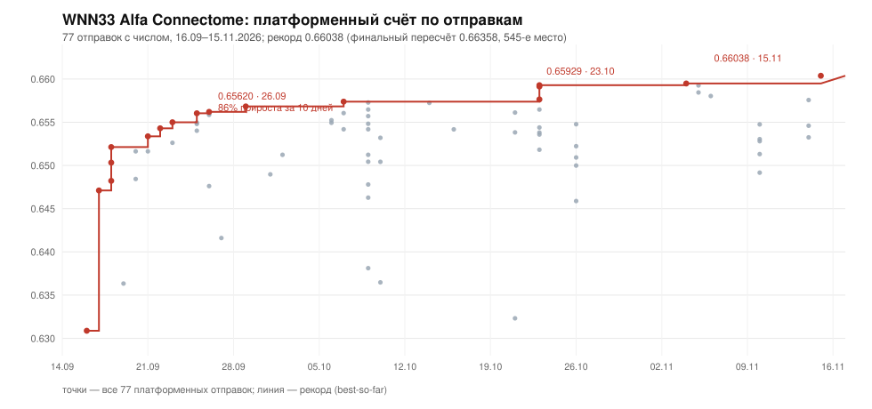
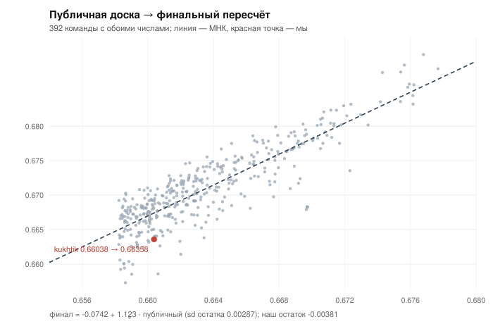

# Alfa Connectome (Wunder Fund, 2026) — исследовательский разбор

**Итог: 0.66038 публично (282-е место из 5841 зарегистрированных), 0.66358 на финальном
пересчёте (545-е место из 1448 команд со счётом), 104 отправки за 60 дней. Призовая зона —
свыше 0.68566, то есть мы недобрали 0.022 на финале.**

Этот репозиторий — не «решение соревнования», а исследование: как за 60 дней набрать +0.0295
к базовому уровню организаторов, где именно кончился рост, чем он кончился и что в этом
классе задач отделяет 0.66 от 0.67+. Все числа воспроизводимы из артефактов, которые лежат
рядом: реестр отправок, таблица закрытых осей, разобранная финальная доска, статистика
сдвига публичной доски на финальную.

> *EN abstract.* A post-mortem of a 60-day solo campaign on the Wunder Fund "Alfa Connectome"
> streaming order-book challenge (112 features, 20,000-row sequences, 39.4M rows scored on one
> CPU core in 60 minutes, clipped weighted Pearson metric). Final 0.66358 (545/1448 scored
> teams). The repository documents the trajectory, the 86 closed research axes, the 77 scored
> submissions, and a quantitative comparison with the teams that reached >0.67.

## Что здесь есть

| раздел | о чём |
|---|---|
| [docs/01_task_and_metric.md](docs/01_task_and_metric.md) | задача, контракт инференса, метрика и почему она обманчива |
| [docs/02_data_findings.md](docs/02_data_findings.md) | четыре размера тика, структура целей, маска, сдвиг периодов |
| [docs/03_our_pipeline.md](docs/03_our_pipeline.md) | что именно мы построили: признаки, GRU 96×2, лосс, маска, ансамбль, рантайм |
| [docs/04_results.md](docs/04_results.md) | траектория 77 отправок, финальная доска, сдвиг публичный→финальный |
| [docs/05_what_did_not_work.md](docs/05_what_did_not_work.md) | 86 закрытых осей с числами и разбором, какие закрытия были ошибочными |
| [docs/06_landscape.md](docs/06_landscape.md) | что опубликовали команды выше нас и на чём именно они набрали разрыв |
| [docs/07_lessons.md](docs/07_lessons.md) | семь методологических уроков кампании |
| [docs/08_measurement_discipline.md](docs/08_measurement_discipline.md) | дисциплина измерений: метрика, тихие ошибки, чистота среза, время, отбор |
| [appendix/](appendix) | `scores.md` и `scores.csv` (86 отправок), `closed_axes.md`, `finals_standings.csv` (1448 строк), `shift_stats.json`, `archive_index.csv` |
| [code/](code) | ключевые файлы пайплайна: обучение, оценка, упаковка (данные не включены) |

## Главные числа

| | значение |
|---|---|
| первый сабмит | 16.09, 0.63088 |
| 86 % всего прироста | первые 10 дней (0.63088 → 0.65620 к 26.09) |
| рекорд публичной доски | 0.66038 (`cand_comp11`, 15.11): 7 членов, 8 графов, 41–44 мин |
| финальный пересчёт | 0.66358, 545-е место, ▼263 к публичному рангу |
| медиана сдвига поля | +0.00795 (мы +0.00320 — 8.8-й процентиль) |
| призовая восьмёрка | 0.68566 … 0.69039 |
| отправок / коммитов / документов | 104 / 4485 / 683 (90 338 строк) |

## Три вывода, ради которых это опубликовано

1. **Счёт рос смешиванием, а не моделью.** Первые десять дней дали +0.0253 на кросс-семейных
   блендах; следующие 50 дней дали +0.0042 на 51 отправке. Когда разнородные члены кончились,
   остались копии: эффективная размерность пула из 12 кандидатов — 1.0064 при 99.68 % следа на
   первой компоненте PCA.
2. **Критерий приёмки был абсолютным, и это закрыло ровно те оси, на которых стоят
   победители.** Дистилляция дала +0.0082 платформы 20.09 и была закрыта, потому что соло не
   догнала текущую запись. Ширина 256–400 проверялась на старых метках и закрывалась как шум.
   У команды, занявшей 58-е место, ширина окупилась «только после того, как метки стали чище».
3. **Прибор переноса стал основным расходом времени.** К 28.10 закон local→platform имел
   R² = 0.154, а на слот-гейт требовалось +0.0217 локально. Прибор честно говорил «нет» три
   недели подряд, и вместо смены класса рецепта мы уточняли прибор: 334 документа про перенос,
   425 про слоты, 24 про дистилляцию.

## Чего в репозитории нет

Данных соревнования (они принадлежат организаторам), весов конкурентов, чужих текстов. Разбор
чужих решений — пересказ с числами и ссылками на их публичные репозитории, см.
[docs/06_landscape.md](docs/06_landscape.md). Веса наших моделей и полные дампы предсказаний
(3.4 ГБ) в публичную часть не выложены.

## Лицензия

MIT для текста и кода. Числа и таблицы — наши собственные измерения; при использовании
ссылайтесь на репозиторий.
