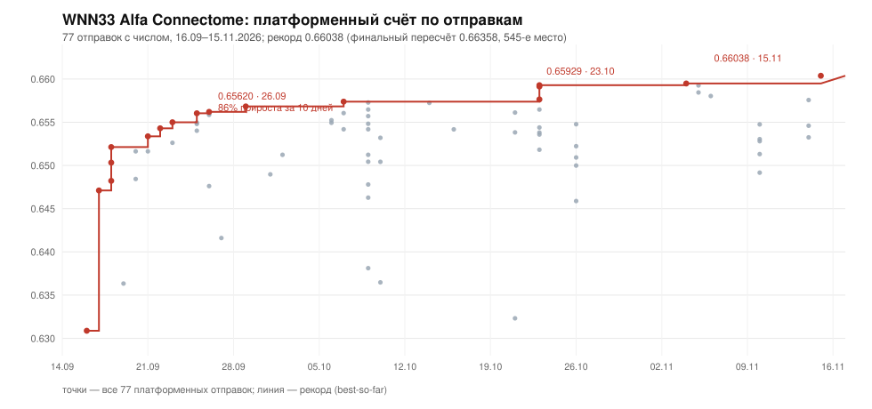
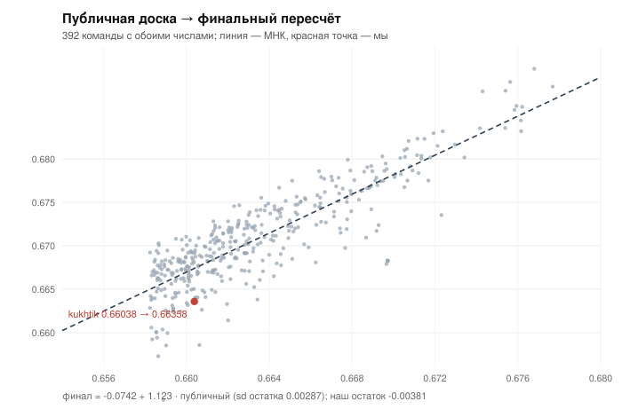

# 4. Результаты

## 4.1 Траектория

Реестр платформы: 86 записей, из них 77 со счётом (остальные — таймауты и незавершённые
прогоны). Кривая рекорда:

| дата | модель | платформа | время | членов |
|---|---|---|---|---|
| 2026-09-16 | `m1` | 0.63088 | 33m04s | 1 |
| 2026-09-17 | `m4` | 0.64711 | 25m52s | 1 |
| 2026-09-18 | `ens47c` | 0.65033 | 40m11s | 2 |
| 2026-09-18 | `ens_c05_m4` | 0.65213 | 40m20s | 2 |
| 2026-09-21 | `ens_mcv10v2_m4` | 0.65337 | 68m11s | 2 |
| 2026-09-22 | `mhybrid` | 0.65430 | 26m02s | 1 |
| 2026-09-23 | `ens_mhybrid_m4` | 0.65500 | 39m06s | 2 |
| 2026-09-25 | `ens_ovs_e3mc05` | 0.65604 | 40m41s | 2 |
| 2026-09-26 | `ens_swamc05` | 0.65620 | 39m52s | 2 |
| 2026-09-29 | `ens_tri2m` | 0.65683 | 52m41s | 3 |
| 2026-10-07 | `ens_c2` | 0.65739 | 57m12s | 3 |
| 2026-10-23 | `ens_m9a` | 0.65914 | 57m52s | 3 |
| 2026-10-23 | `ens_m9b` | 0.65929 | 59m21s | 3 |
| 2026-11-04 | `cand_o5` | 0.65948 | 31m58s | 0 |
| 2026-11-15 | `cand_comp11` | 0.66038 | 41-44m | 7 |

По неделям отправок: объём усилий нарастал, а счёт почти не двигался.

| неделя (ISO) | отправок | лучший | медиана |
|---|---|---|---|
| 38 | 10 | 0.65213 | 0.64822 |
| 39 | 15 | 0.65620 | 0.65430 |
| 40 | 3 | 0.65683 | 0.65124 |
| 41 | 18 | 0.65739 | 0.65419 |
| 42 | 2 | 0.65724 | 0.65724 |
| 43 | 11 | 0.65929 | 0.65439 |
| 44 | 5 | 0.65477 | 0.65093 |
| 45 | 4 | 0.65948 | 0.65926 |
| 46 | 8 | 0.65757 | 0.65325 |

Итог: **+0.0295** за 60 дней, из них **+0.0253 (86 %) за первые десять дней**. Между 26.09 и
15.11 сделана 51 отправка и набрано +0.0042. Между 23.10 и 15.11 — 12 отправок и +0.0011.

## 4.2 Финальная доска

Платформа пересчитывает приватный период и публикует финальный счёт с рангом и перемещением
относительно публичной доски (1448 строк).

| | |
|---|---|
| наша строка | **545-е место, 0.66358, ▼263** (публично было 282-е) |
| 1-е место | `baselinemax` 0.69039 (публично был 2-м) |
| 2-е | `blanc` 0.68887 |
| 3-е | `Gargantua` 0.68834 (публично был 1-м) |
| 8-е (граница призов) | `Mech_Korolya_Artura` 0.68566 |
| выше 0.68 / 0.67 | 21 / 195 команд |
| разрыв до восьмёрки | **0.02208** |

## 4.3 Сдвиг публичный → финальный: где мы потеряли две трети сигнала

Сшивка всех 400 команд публичного снапшота с разобранной финальной доской.

| | Δ (финал − публичный) |
|---|---|
| медиана поля (400 команд) | **+0.00795** (IQR 0.00609…0.00942) |
| призовая восьмёрка, медиана | +0.01156 |
| **мы** | **+0.00320** (8.8-й процентиль) |

МНК-линия: `финал = -0.0742 + 1.123 · публичный`, sd остатка
0.00287. Она предсказывала нам 0.66739; мы сели на **-0.00381** ниже
собственной публичной линии.

Читается так: у 91 % команд сдвиг на приватном периоде был больше нашего. Наши копии одного
предсказания выучили публичный период и плохо перенеслись на другой; модели с переносимым
сигналом выиграли на пересчёте втрое больше.

## 4.4 Финальные отправки

Три финальные отправки 15.11 дали 0.65757 / 0.65325 / 0.65460 — все ниже рекорда 0.66038,
взятого 14.11. Платформа хранит лучший счёт, поэтому рекорд не пострадал. Но последний день
кампании не дал ничего: механизмы, проверенные в заключительные сутки (дозы, chain-ветка,
режимный проход), результат не подняли.

## 4.5 Сколько это стоило

| | |
|---|---|
| отправок | 104 (86 в реестре, 13 не заведены, 2 финальные без сохранённых ZIP) |
| коммитов | 4485 |
| документов в архиве | 683 (90 338 строк) |
| eval-артефактов | 3118 JSON |
| чекпоинтов | 546 |
| GPU-клеток к 27.10 | 111 (148.1 ч) |
| собранных ZIP | 61 в рабочем каталоге + 99 в архиве репозитория |

Темп был высокий, отдача — нет. Это не история «мало работали».
